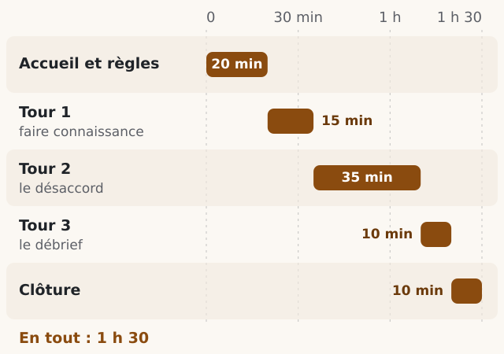
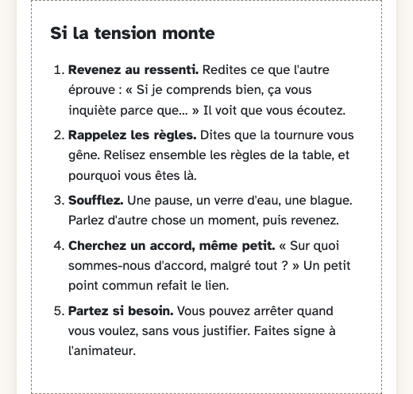
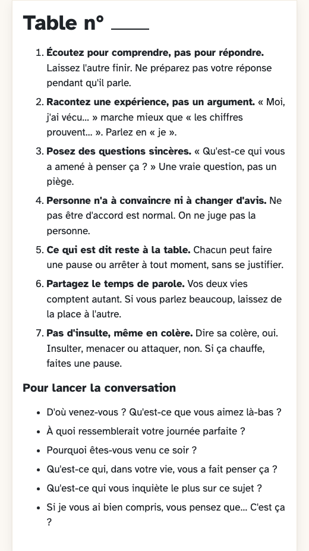

<!-- Fichier produit à partir de guide.md, organiser.md et des fiches du site Deux chaises : ne le modifiez pas, proposez plutôt vos changements dans guide.md ou organiser.md (voir CONTRIBUTING.md). -->

# 

  

Deux chaises est une méthode libre pour organiser une heure et demie de conversation en tête-à-tête entre deux personnes qui ne pensent pas pareil, dans une bibliothèque, une association ou un tiers-lieu. C'est un dialogue : on fait connaissance et on cherche à comprendre comment l'autre en est arrivé là. Ce n'est pas un débat : il n'y a rien à gagner, et personne n'a à changer d'avis.

## Utiliser

Tout tient dans ce dossier, sans ordinateur : imprimez, posez sur les tables, lisez à voix haute.

| | Pour qui | Quoi |
|:-:|---|---|
| 🗂️ **[organiser.md](organiser.md)** | L'organisateur | Lieu, affiche, paires, déroulé, animateur |
| 📖 **[guide.md](guide.md)** | Tout le monde | Les 7 règles, avant, pendant, si la tension monte, débrief |
| 🖨️ **[cartons/](cartons/)** | À imprimer | Affiche, questionnaire, paires, carton de table, débrief… |
| 🔎 **[correspondance-fqp.md](correspondance-fqp.md)** | Les curieux | Les 10 règles de Faut qu'on parle et les nôtres |

Une rencontre dure 1 h 30, en 5 temps ([le déroulé minute par minute](organiser.md#tenir-le-temps)) :

## Pourquoi ça marche

- **1 conversation** : Allemagne, 748 personnes appariées à un opposé, mesuré une semaine après ; effet net (0,27 écart-type). [Fang, Heuser & Stötzer, J. Public Econ., 2025](https://doi.org/10.1016/j.jpubeco.2025.105309)
- **+9 points sur 100** : États-Unis, 478 personnes, en visio ; mesuré juste après, disparu au bout de 3 mois. Parler d'emblée du désaccord : aucun effet. [Santoro & Broockman, Science Advances, 2022](https://doi.org/10.1126/sciadv.abn5515)
- **4 mois** : États-Unis, 6 869 électeurs rencontrés à leur porte ; effet petit (d = 0,08) mais durable. [Kalla & Broockman, APSR, 2020](https://doi.org/10.1017/s0003055419000923)

## Les 7 règles

Le texte des règles est dans [guide.md](guide.md#les-règles).

## À imprimer

| Si la tension monte | Ce que j'emporte | Les règles de table |
|:-:|:-:|:-:|
|  |  |  |

Tous les cartons, dont l'affiche, le questionnaire et la grille des paires : [cartons/](cartons/).

## Adapter (forker)

Copiez ce dossier (sur GitHub : bouton **Fork**) et changez ce que vous voulez : les mots, la durée, les règles, la langue. Gardez si possible les trois piliers : faire connaissance avant le désaccord, écouter sans interrompre, finir par le débrief.

- ✍️ **Créditez** : « D'après Deux chaises, REX club (CC BY-SA 4.0). Inspiré de Faut qu'on parle (guide de conversation 2026). »
- 🔁 **Gardez la même licence.**
- 📌 **Ajoutez votre version** dans [ADAPTATIONS.md](ADAPTATIONS.md).

## Proposer une amélioration

Pas besoin de savoir coder : racontez votre atelier, proposez un changement ou une traduction.

- 💬 **Ouvrez un ticket**, ou modifiez [guide.md](guide.md) et [organiser.md](organiser.md) sur GitHub (icône crayon).
- 📚 Chaque chiffre ajouté a sa source : tout est dans [CONTRIBUTING.md](CONTRIBUTING.md).
- 🤝 Les échanges suivent nos règles de table : [CODE_OF_CONDUCT.md](CODE_OF_CONDUCT.md).

## Licence

- 📄 **Textes** : [CC BY-SA 4.0](https://creativecommons.org/licenses/by-sa/4.0/deed.fr), à copier, adapter et redistribuer (même à des fins commerciales), en créditant « Deux chaises, REX club », en indiquant vos modifications, sous la même licence. Texte complet : [LICENSE](LICENSE).
- 💻 **Code du site** Deux chaises : licence MIT. Ce dossier ne contient pas de code.

Sources : Faut qu'on parle et études citées

- **Faut qu'on parle** : la méthode s'inspire de leur [guide de conversation 2026](https://www.fautquonparle.org/wp-content/uploads/2026/09/FQP-Guide-conv2026.pdf) et de leur édition nationale (<https://www.fautquonparle.org/>). On reprend leurs idées avec nos mots ; leurs textes ne sont pas sous licence libre et ne sont pas recopiés ici. Voir [correspondance-fqp.md](correspondance-fqp.md).
- **Études citées** (seuls nos résumés sont sous CC BY-SA 4.0, les études restent à leurs auteurs) :

  - Fang, Heuser & Stötzer, « How in-person conversations shape political polarization: Quasi-experimental evidence from a nationwide initiative », Journal of Public Economics, 2025. <https://doi.org/10.1016/j.jpubeco.2025.105309>
  - Santoro & Broockman, « The promise and pitfalls of cross-partisan conversations for reducing affective polarization: Evidence from randomized experiments », Science Advances, 2022. <https://doi.org/10.1126/sciadv.abn5515>
  - Kalla & Broockman, « Reducing Exclusionary Attitudes through Interpersonal Conversation: Evidence from Three Field Experiments », American Political Science Review, 2020. <https://doi.org/10.1017/s0003055419000923>
  - Armin Falk (université de Bonn), étude de Deutschland spricht 2018, présentée par My Country Talks. <https://www.mycountrytalks.org/events/impact>
  - Fishkin, Siu, Diamond & Bradburn, « Is Deliberation an Antidote to Extreme Partisan Polarization? Reflections on “America in One Room” », American Political Science Review, 2021. <https://doi.org/10.1017/s0003055421000642>
  - Bilans publiés par Faut qu'on parle (Fonds Bayard et partenaires). <https://www.fautquonparle.org/> ; <https://ensembles.substack.com/p/faut-quon-parle-le-bilan-dun-drole>

## Version

Version 1.0.0. Les changements sont dans [CHANGELOG.md](CHANGELOG.md). Trois parties : **majeure** (2.0.0, une règle change), **mineure** (1.1.0, une partie s'ajoute), **correctif** (1.0.1, une correction).

---

Deux chaises, REX club · Texte sous licence [CC BY-SA 4.0](https://creativecommons.org/licenses/by-sa/4.0/deed.fr) ([conditions](README.md#licence)) · Inspiré de [Faut qu'on parle (guide de conversation 2026)](https://www.fautquonparle.org/wp-content/uploads/2026/09/FQP-Guide-conv2026.pdf).
